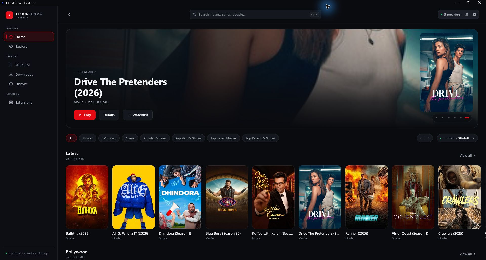
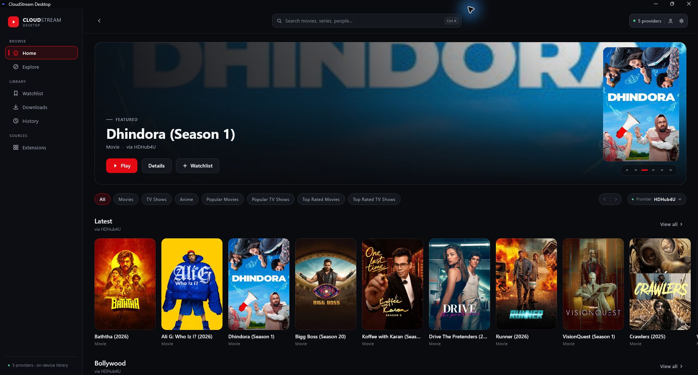
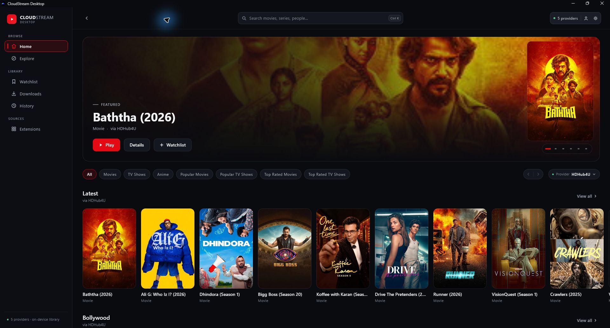
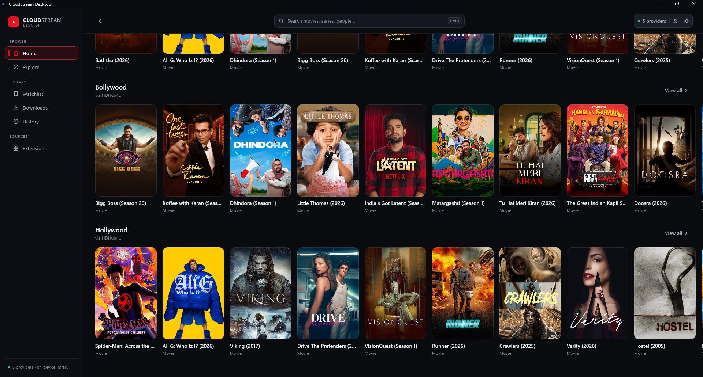

# CloudStream Desktop

> **Work in progress.** This Windows desktop application is under active development. Some features, including provider search, Continue Watching artwork, and high-quality HDR playback, still need further verification. Do not treat current builds as a stable release.

CloudStream Desktop is a Kotlin/Compose Multiplatform Windows application built from and alongside the open-source CloudStream project. It aims to provide a desktop interface for browsing media through user-installed extensions and playing supported streams. The app does not include or endorse any particular streaming source; users are responsible for choosing lawful extensions and content.

This repository currently focuses on Windows. It is not an official release of the upstream CloudStream Android application.

## Current status

- Windows desktop build and MSI packaging are available.
- Extension support, search, playback, and watch history are being developed and tested.
- Provider and stream compatibility can vary. Some codecs, HDR formats, and high-bitrate streams also depend on the user's PC, graphics hardware, display, and network.
- No stable-release or automatic-update promise is made yet.

## Windows installer

The latest locally verified Windows MSI is available at [CloudStream-1.0.1.msi](artifacts/CloudStream-1.0.1.msi). This is a development build, not a stable release. Verify the SHA-256 digest in [CloudStream-1.0.1.msi.sha256](artifacts/CloudStream-1.0.1.msi.sha256) before installing. Installing a newer MSI does not enable automatic updates; users must install a future build manually.

## Home screen

These screenshots show the running Windows desktop app. The Home screen includes the featured carousel, provider selector, category filters, and poster rails.

<table>
  <tr>
    <td></td>
    <td></td>
  </tr>
  <tr>
    <td></td>
    <td></td>
  </tr>
</table>

## Build on Windows

Requirements: Git, JDK 17, and the included Gradle wrapper. Set `JAVA_HOME` to your JDK 17 folder, then run these commands from the repository root in PowerShell:

```powershell
$env:JAVA_HOME = "C:\Path\To\JDK17"
.\gradlew.bat :desktopApp:compileKotlinJvm
.\gradlew.bat :desktopApp:createDistributable :desktopApp:packageMsi
```

The MSI is generated under `desktopApp\build\compose\binaries\main\msi\`.

## Project history and upstream attribution

This desktop work contains code derived from the CloudStream project. The upstream project and its license notices remain in the source tree. See [LICENSE](LICENSE) and the preserved [upstream Android README](docs/upstream-cloudstream/README.android-upstream.md). Please review upstream and third-party notices before redistributing builds.

## Reporting problems

When reporting a bug, include the app version, Windows version, steps to reproduce, and relevant logs with private information removed. Do not post passwords, API tokens, private stream links, or personal data.

## License

See [LICENSE](LICENSE). Check the licenses of included libraries and assets before redistributing the application.
